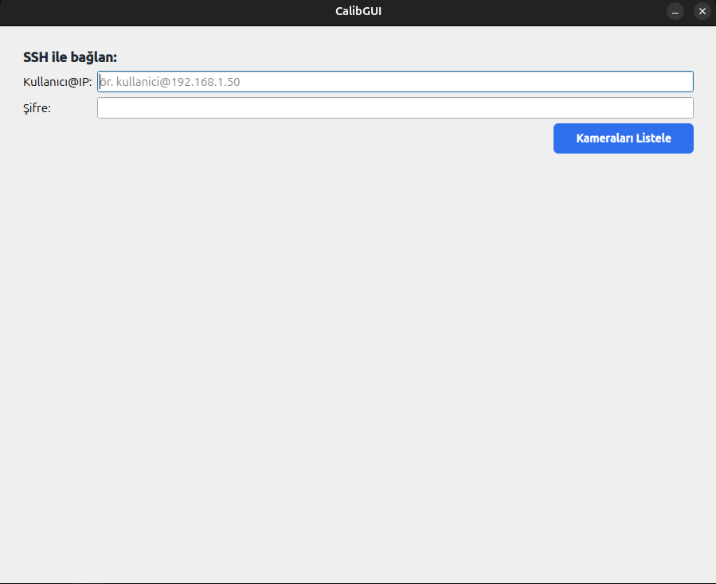
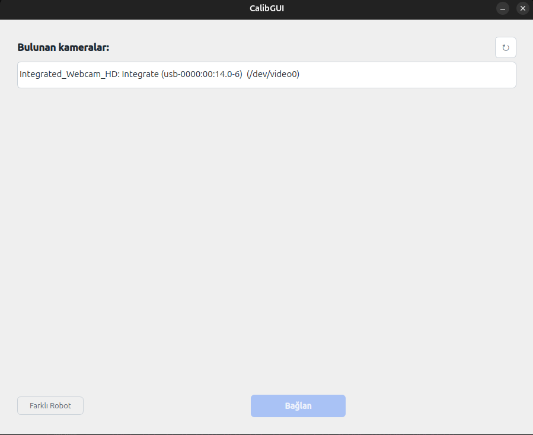
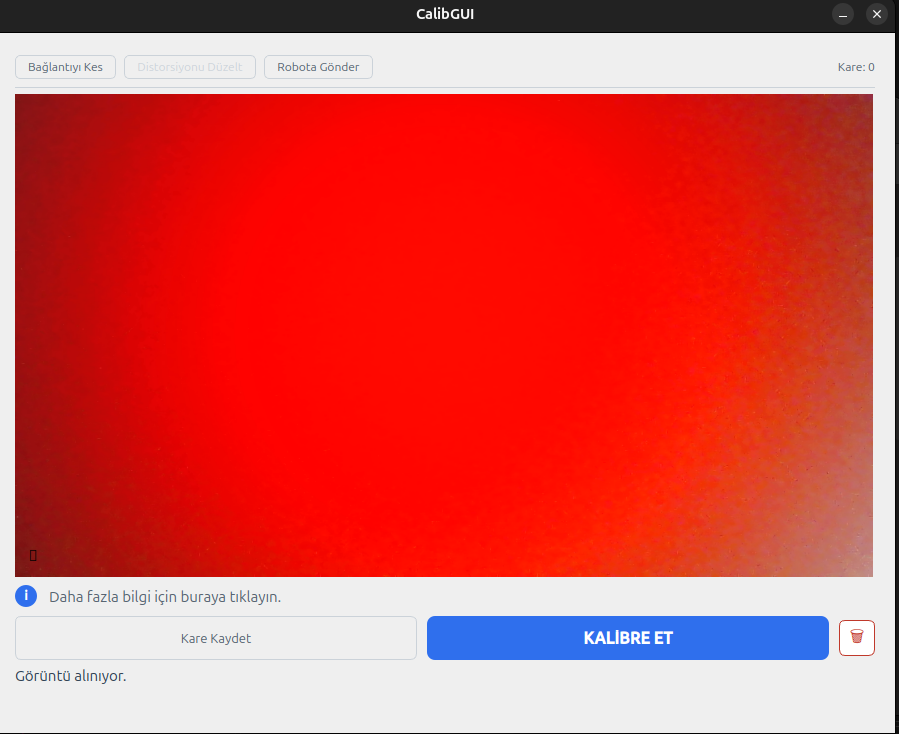
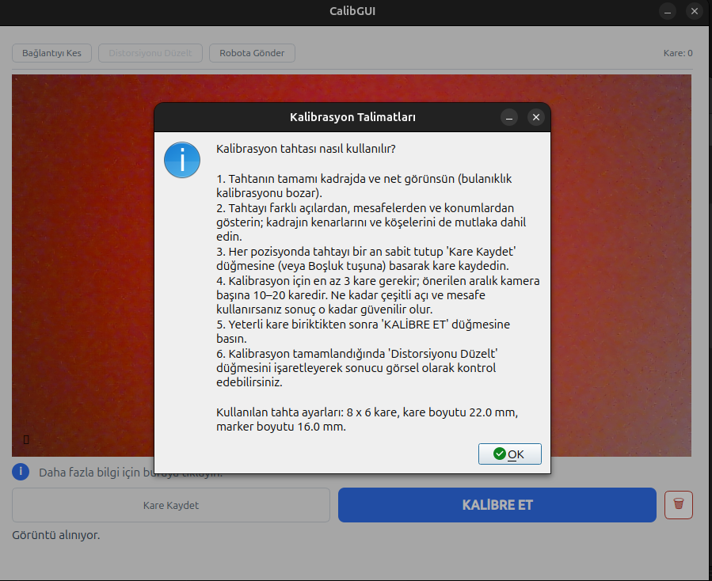

# CalibGUI

Minimal Qt console for camera calibration. Scoped to just:

1. Enter a robot's SSH target (`user@host`) and password; CalibGUI connects via
   `sshpass` and runs `streamserver.sh -l` to list connected cameras.

   

2. Pick a camera; CalibGUI starts `streamserver.sh -d <device>` on the robot and
   receives the resulting RTP raw-video stream locally via GStreamer.

   

3. Capture calibration images (Space or "Kare Kaydet").
4. Run ChArUco calibration against the captured frames (Kalibrate ET).
5. Preview the result with the undistort toggle.
6. Push the calibration to the robot ("Robota Gönder").
7. Clear/reset the saved-frames folder on demand.

   

   The "ⓘ" button shows the in-app instructions dialog, which also summarises
   the active board settings:

   

## Scripts (deployed to `~/scripts/` on the robot)

All four scripts live in `CalibGUI/scripts/` and must be present at
`~/scripts/` on the robot.

### `streamserver.sh`

Streams uncompressed video (v4l2 → RTP raw/UDP) from the robot back to
whichever machine SSHed in. Depends on `map_cams.sh` being in the same
directory.

```sh
ssh user@<robot-ip> ~/scripts/streamserver.sh -l          # list cameras
ssh user@<robot-ip> ~/scripts/streamserver.sh -d /dev/video0
ssh user@<robot-ip> ~/scripts/streamserver.sh -d frontcam  # mapped name works too
```

Stream parameters: 1280×720, YUY2 input at 10 fps, sent as UYVY at 2 fps.
CalibGUI runs both of these itself, there's no need to run them by hand
except to debug connectivity.

// TODO: was this necessary?
Self-healing: if a previous stream for the same device is still running (e.g.
from an abnormal client disconnect), `streamserver.sh` kills it before starting
a new one, using a per-device PID file at `/tmp/streamserver-<device>.pid`.

### `stop_stream.sh`

Stops a running `streamserver.sh` session for a given device and waits for it
to exit. CalibGUI calls this over SSH whenever it disconnects cleanly.

```sh
~/scripts/stop_stream.sh /dev/video0
~/scripts/stop_stream.sh frontcam     # mapped name works too
```

### `map_cams.sh`

Resolves `/dev/videoX` kernel nodes to friendly udev symlink names by reading
`/etc/udev/rules.d/99-trhex_cameras.rules`. Used by both `streamserver.sh` and
`copy_undistort.sh` to translate between raw device nodes and human-readable
names like `frontcam`.

```sh
~/scripts/map_cams.sh                 # print all name = /dev/videoX pairs
~/scripts/map_cams.sh -n frontcam     # print the /dev/videoX node for a name
~/scripts/map_cams.sh -p /dev/video0  # print the name for a node
```

Camera names shown in CalibGUI's picker come from this mapping. If a device
has no mapping entry its raw `/dev/videoX` path is shown instead.

### `copy_undistort.sh`

Writes a calibration result into the robot's config tree. Called by CalibGUI's
"Robota Gönder" button; can also be run by hand.

```sh
~/scripts/copy_undistort.sh <device> <fx> <fy> <cx> <cy> <dist0> [dist1 ...]
```

Output: `~/TRHex/config/robots/<hostname>/<camera-name>.rc`, containing
`bool undistort = true;` and a `struct undistort_params { … }` with the
intrinsic values. The `<camera-name>` is the `map_cams.sh` name for the
device, or the basename of the device node if unmapped.

## Calibration

CalibGUI uses OpenCV's **ChArUco** calibration pipeline (`DICT_4X4_50`).
Default board parameters (all configurable in `include/config.h`):

| Parameter | Default |
|---|---|
| Squares X | 8 |
| Squares Y | 6 |
| Square side | 22 mm |
| Marker side | 16 mm |
| Min valid frames | 4 |

Captured frames are stored in `Frames/<ssh-target>/` (PNG). Calibration
results are saved to `Calibrations/<ssh-target>/0.yaml` and loaded back on the
next session with the same target.

## Building CalibGUI

CalibGUI is a standalone qmake project. Requires GStreamer 1.0
(`gstreamer-1.0`, `gstreamer-video-1.0` via pkg-config), Qt 5, and OpenCV 4.
`sshpass` must also be installed at runtime on the host machine.

```sh
sudo apt install sshpass
qmake CalibGUI.pro
make
```
